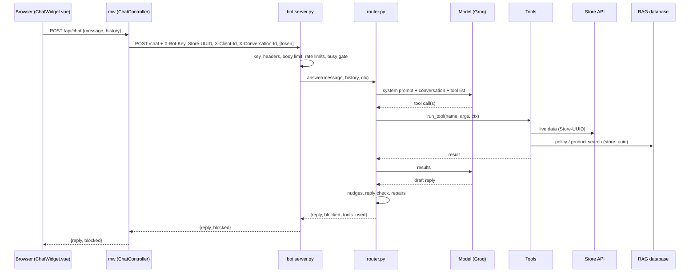
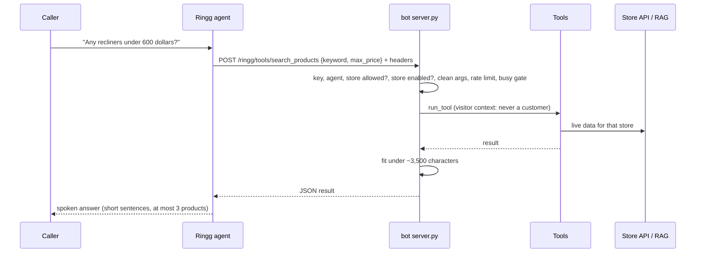

# How the B3 shopping assistant works: every flow, from data to answer

*Written 26 Nov 2026 from the code on branch `cleanup-and-voice-tools`. Covers the website chat, the Ringg.AI voice agent,
the knowledge (RAG) database and the logging. File references are to this repo unless they name `mw` or `api`.*

**Contents**

1. [The pieces](#1-the-pieces)
2. [Where every piece of data comes from](#2-where-every-piece-of-data-comes-from)
3. [How the assistant knows which store: the Store-UUID](#3-how-the-assistant-knows-which-store-the-store-uuid)
4. [Flow A: a website chat message, end to end](#4-flow-a-a-website-chat-message-end-to-end)
5. [Flow B: inside one chat turn (the router)](#5-flow-b-inside-one-chat-turn-the-router)
6. [Flow C: each tool, from data to result](#6-flow-c-each-tool-from-data-to-result)
7. [Flow D: checking and presenting the reply](#7-flow-d-checking-and-presenting-the-reply)
8. [Flow E: a logged-in customer's orders](#8-flow-e-a-logged-in-customers-orders)
9. [Flow F: a Ringg voice call](#9-flow-f-a-ringg-voice-call)
10. [Flow G: filling the knowledge database (RAG ingest)](#10-flow-g-filling-the-knowledge-database-rag-ingest)
11. [Flow H: what is recorded (events, logs, traces)](#11-flow-h-what-is-recorded-events-logs-traces)
12. [Start-up, caches, timeouts and limits](#12-start-up-caches-timeouts-and-limits)
13. [When something fails: what the customer sees](#13-when-something-fails-what-the-customer-sees)
14. [Settings reference](#14-settings-reference)
15. [Code map](#15-code-map)

---

## 1. The pieces

```
 Shopper's browser                         Caller (phone / web voice)
   |  chat widget (mw: ChatWidget.vue)        |  Ringg.AI voice agent (Ringg's cloud, Ringg's own model)
   v                                          |
 mw  (storefront, Laravel + Vue, port 8000)   |  tool calls  POST /ringg/tools/<tool>
   |  POST /chat  with trusted headers        |  call events POST /webhooks/ringg
   v                                          v
 +---------------------- bot service (this repo, FastAPI, port 8100) ----------------------+
 |  server.py  -> router.py (chat only) -> model (Groq by default)                         |
 |                   |                                                                     |
 |                   +-> guardrails.run_tool -> bot/tools/*   <-- Ringg calls the same tools |
 +-----------|--------------------------------------------|--------------------------------+
             | Store-UUID header                          | SQL (read only)
             v                                            v
 api  (store back office, Laravel, port 8001)       RAG database (Postgres + pgvector, on Neon)
   |  picks the store's own database from the UUID    one table rag_chunks, every row tagged with its store
   v
 that store's MySQL database (products, prices, orders, pages, hours...)
```

| Piece | What it is | Owns |
|---|---|---|
| **mw** | The storefront every store runs on (one codebase). | The chat widget, the trusted server route that calls the bot, the customer's login session. |
| **bot service** | This repo. One process serves every store. | The prompt, the tools, the reply checks, the Ringg endpoints, the funnel events. Holds no store database login. |
| **api** | The store back office. | All live store data. Picks the store's database from the `Store-UUID` header. |
| **RAG database** | Postgres with pgvector, hosted on Neon. | Searchable copies of each store's policy/FAQ/guide/blog pages and product descriptions. |
| **Model** | Groq `openai/gpt-oss-20b` by default (`SJ_LLM_PROVIDER`). | Decides which tools to call and writes the reply. Never sees a database or a secret. |
| **Ringg.AI** | Hosted voice agent (agent "B3 DEV"). | Listening, speaking, the phone line or web voice widget. Calls our tools for store facts. |

---

## 2. Where every piece of data comes from

**Rule of thumb:** anything that changes (prices, stock, hours, orders) is read **live from the store API** on every question.
Only long text (policies, FAQs, guides, blogs, product descriptions) is **copied** into the RAG database, so it can be searched by meaning.

| Data | Source | How the bot gets it | Kept or cached by the bot? |
|---|---|---|---|
| Store name, phone, email, address, regular hours | Store API `GET /stores` | `get_store_info` tool | Contact text cached 5 min per store (for the reply check) |
| Categories | `GET /categories/tree` | `list_categories` | No |
| Brands | `GET /brands` | `list_brands`; also brand matching in the router | Brand list cached 5 min per store |
| Products, prices, options | `POST /products/search`, `POST /categories/{slug}/products`, `GET /product/{slug}` | `search_products`, `get_product_details`, `recommend_products` (live check) | No: always live |
| Filter values (colors, bed sizes...) | Facets of `POST /products/search` | `list_attribute_values`, attribute filters in `search_products` | No |
| Stock | none: the catalog has no stock data | `check_inventory` always answers "unknown" | — |
| Shipping and pickup | The store's own policy/FAQ text in the RAG database | `get_shipping_options` (`GET /shipping-options` exists in the API but is not used yet) | — |
| Policies, FAQs, guides, blogs, brand pages | Copied from `GET /page/{slug}`, `GET /faqs/global`, `GET /blogs/...` by the ingest (section 10) | `search_policies` | Stored in the RAG database until the next ingest |
| Product descriptions for "what should I buy" | Copied from `GET /product/{slug}` by the ingest | `recommend_products`, then re-read live | Stored in the RAG database; price there is only a hint |
| A customer's orders | `GET /orders` with **that customer's login token** | `get_order_status` (chat only, logged-in only) | No |
| The store's settings (name, domains, kind of store, on/off, rules) | `stores/<store-uuid>.json` in this repo | Read at the start of each chat | Re-read every 60 s, no restart needed |

**What the bot never touches:** any store database directly, the `api`'s database logins, customers' personal details
beyond the order fields listed in section 8, payment data.

---

## 3. How the assistant knows which store: the Store-UUID

Every store on the platform has a unique ID, the **Store-UUID** (South Jackson: `56695974416925887669406417382718`).

1. **The storefront knows its own store.** `mw`'s `ChatController::resolveStoreUuid` takes it from `services.api.store_uuid`
   (`VITE_STORE`) or the store data `mw` loaded for its domain.
2. **It is sent as a header, never in the message body.** `mw` adds `Store-UUID: <uuid>` on the server side. The bot rejects
   any body field other than `message` and `history`, so a shopper cannot name another store.
3. **The bot loads that store's settings** from `stores/<uuid>.json` (`bot/stores.py`, `bot/store_config.py`). No file, or
   `"enabled": false` → the chat is refused with "The shopping assistant isn't available right now", and no model call is made.
   Nothing ever falls back to another store's settings.
4. **Every data call carries it.** `bot/api_client.py` sends `Store-UUID` on every request; the API looks the store up in its
   tenants list and switches to **that store's own database**. Every RAG query has `WHERE store_uuid = ...`.
5. **For voice**, the store comes from the call's `store_uuid` variable (set by the store's web page or the call), checked
   against `RINGG_AGENT_STORES` (section 9).

The same UUID is also the settings file's name, the RAG rows' tag, and the funnel events' `store` field.

---

## 4. Flow A: a website chat message, end to end



### A1. In the browser (`mw/resources/js/index/components/ChatWidget.vue`)
- The widget keeps the conversation in `sessionStorage` (last 30 messages) and a conversation ID per tab.
- On send it posts `{"message": ..., "history": [last turns as {role, text}]}` to `mw`'s `/api/chat`, plus
  `X-Conversation-Id`, and the login token as `Authorization: Bearer` if the customer is logged in.
- The browser never sends the store or who the customer is in a way the bot trusts; `mw` decides both.

### A2. In `mw` (`mw/app/Http/Controllers/ChatController.php`)
1. Refuses with "unavailable" if chat is switched off (`BOT_CHAT_ENABLED`) or the bot address/key/store is not configured.
2. Validates the body: only `message` (1–1,000 chars) and `history` (≤ 10 items of `{role: user|assistant, text}`).
   The browser's `history` is checked for shape and then **ignored**: it lives in sessionStorage, so anyone can edit
   it, and the bot treats prices in earlier assistant turns as already verified. The history sent to the bot is the
   one `mw` saved in the customer's session (`chat_history_<store>`: the current conversation id and its last 10
   entries, the bot's whole `reply` each time). A new conversation id starts empty; with no session, no history is sent.
3. Builds the **trusted headers**:
   - `X-Bot-Key`: the shared service key (`BOT_SERVICE_KEY`).
   - `Store-UUID`: the storefront's own store.
   - `X-Client-Id`: the visitor's IP (or session ID): used for rate limits only.
   - `X-Conversation-Id`, `X-Request-Id`: for grouping and tracing.
   - `X-Customer-Token` / `X-Customer-Uuid`: only for a logged-in customer, from the session (saved at login) or the bearer token and its own `sub`.
4. Calls the bot's `POST /chat` (timeout `BOT_SERVICE_TIMEOUT`) and passes back `{reply, blocked}`. A 429 becomes
   "You are sending messages too quickly", a 503 "The assistant is busy", anything else "isn't available right now".

### A3. In the bot's HTTP layer (`bot/server.py`)
In order, before any model call:
1. **Body size**: over 16 KB → 413.
2. **Service key**: wrong or missing `X-Bot-Key` → 401. No key configured → 503 (fail closed). A per-store key map is supported.
3. **Store settings folder**: without `BOT_STORE_CONFIG_DIR` the service refuses (503) unless `BOT_ALLOW_DEV_DEFAULTS=1`.
4. **Headers**: `Store-UUID`, `X-Client-Id` must be present and well formed; customer token and UUID are format-checked.
5. **Body**: only `message` and `history`, with the limits above (extra fields → 422).
6. **Rate limits**: 20 chats/min per visitor per store, 300/min per store → 429 with `Retry-After`.
7. **Busy gate**: at most 8 chats at once → 503 with `Retry-After: 2`.
8. Calls the router (section 5), then writes one **access-log line** and one **funnel event** (section 11).

The context passed on (`bot/context.py` `ChatContext`) holds the store, the client ID, and, only when logged in, the customer
UUID and token. The token is excluded from `repr()`, logs and traces.

---

## 5. Flow B: inside one chat turn (the router)

`bot/router.py` `answer()` → `_answer()`.

### B1. Before the model sees anything
1. **Store settings** → `config_for(ctx)`. Missing/off → fixed "unavailable" reply.
2. **System prompt** → `render_system_prompt(cfg)` (`bot/prompt.py`): one shared template filled with the store's name,
   its kind of store (`bot/verticals.py`: furniture, electronics, veterinary, tires_wheels, general), its shipping example
   and its catalog rules. Nothing in the template names a particular store.
3. **Empty message** → "How can I help you today?".
4. **Gates** (`bot/gates.py`), answered with a fixed reply and **no model call**:
   - attempts to read the bot's instructions, tools or database, or other customers' data → refusal;
   - requests to cancel / change / refund an order → "I can't cancel, change or refund orders in this chat...".
5. **Tool list**: a visitor gets every tool except `get_order_status`; a logged-in customer (token present) gets all of them.

### B2. The model ↔ tools loop
Up to **5 tool calls per message**, plus room for one last answer:
1. Send the model the prompt, the cleaned history (last 10 turns, text only) and the new message.
2. If the model asks for tools: run each through `guardrails.run_tool` (section 6) with the trusted context.
   - The **same call twice** in one turn is answered from memory, not run again.
   - A product search naming a **brand the store carries** is pointed at that brand (`ground_brand_search_ex`, brand list cached 5 min).
   - After 5 calls, further calls get "no more tool calls; answer from what you have".
3. If the model answers without a tool call, the **nudges** (`bot/nudges.py`) may send it back **once each**, in this order:

   | Nudge | When | What the model is told |
   |---|---|---|
   | fresh price | "cheapest/most expensive" answered without a product search | search now with a price sort |
   | keyword | a cheapest-first search with no product-type keyword | search again with the type word (parts and accessories otherwise top the list) |
   | required tool | categories, brands, policies or hours answered from memory | call `list_categories` / `list_brands` / `search_policies` / `get_store_info` |
   | policy first | "I don't have that information" without searching the store's pages | call `search_policies` first |
   | product retry | a misspelt product word went to the policy search and found nothing | correct the spelling and search products |
   | bare contact | the pages answered the question but the reply only gave a phone number | answer from the pages |

4. If the loop ends still calling tools, the model is asked once for a final answer without tools.

### B3. After the draft reply
1. **Holiday hours**: holidays are not in the store data, so a holiday question gets a reply built from the regular hours
   and the store's own phone and email, never a guess.
2. **The reply check and repairs** (section 7).
3. **"I don't have that information" prefix**: a short reply that only points to the store after a weak policy search
   gets this prefix, so it does not read as if the store will supply the answer.
4. Returns `{reply, tools_used, blocked}`; a reply that fails the check becomes the fallback (section 13).

---

## 6. Flow C: each tool, from data to result

All tools are run by `bot/guardrails.py` `run_tool`: unknown tool names are refused, arguments must be a JSON object, and a
crashing tool returns "tool_failed — do not guess, point to the store" instead of an error. Tools validate their own
arguments (allowed keys, caps). Every result carries a `note` telling the model how it may use it.

| Tool | Data source | Returns to the model | Deliberately left out |
|---|---|---|---|
| `search_products` | `POST /categories/{slug}/products` (category) or `POST /products/search` (keyword, `facets: false`) | up to 8 products: name, SKU, slug, live price, brand, image; applied filters; notes on partial results | base/cost price, stock claims |
| `get_product_details` | `GET /product/{slug}` (a SKU is first turned into a slug by a search) | one product: name, price, options with their prices, description, features, dimensions, categories | cost price |
| `recommend_products` | RAG product documents (meaning + keyword search, filters) → up to 10 candidates **each re-read live** with `get_product_details` | 5 products by default (at most 8), name and price from the live read; dropped if gone or outside the price limit on the live price | the stored price (only a hint) |
| `search_policies` | RAG rows of **this store**: `policy`, `guide`, `faq` by default; `blog`, `brand_info` when the model asks for them | up to 6 page chunks with title and link; `found: false` if nothing is close enough | other stores' pages, sentences with the store's `scrub_terms` |
| `get_shipping_options` | `search_policies` limited to policy/guide/FAQ text about shipping and pickup | the store's own wording | rate tables (none in the text) |
| `get_store_info` | `GET /stores` | name, phone, email, address, timezone, regular weekly hours | holiday hours (not in the data) |
| `list_categories` | `GET /categories/tree` | category names and slugs (optionally under a parent / matching a word) | — |
| `list_brands` | `GET /brands` | brand names and slugs | product counts (not in the API) |
| `list_attribute_values` | facets of `POST /products/search` for a keyword | the values a filter group has among matching products | — |
| `check_inventory` | none | always "availability unknown" | — |
| `get_order_status` | `GET /orders` with the customer's own token | section 8 | everything personal |

### How the two searches work
**Policy search** (`bot/tools/search_policies.py`):
1. The question is turned into 768 numbers (Nomic Embed v1.5, `bot/embeddings.py`, prefix `search_query:`).
2. Two queries on **this store's** rows: nearest by meaning (`ORDER BY embedding <=> question`) and Postgres full-text
   (`websearch_to_tsquery`), 8 candidates each.
3. The two lists are merged (reciprocal rank fusion, k = 60); anything below similarity **0.55** is dropped; the top **6** are kept.
4. If the best match is below **0.65**, the result says the pages are only loosely related, so the model must say it does
   not have that information rather than stretch them.
5. One shared database connection is reused (opening one to Neon costs ~1.5 s); a dropped connection is reopened once.

**Product search** (`bot/tools/search_products.py`): the model only chooses filters (keyword, category, brand, price range,
attribute, sort). The tool decides the API calls, reads up to 5 pages of 16, applies the price range on the live prices,
sorts by price itself (the API's price sort lists placeholder products first), hides furniture "component" SKUs (boxes,
boards, loose tops) for furniture stores, and returns at most 8. If it could not see every match, it says so.

---

## 7. Flow D: checking and presenting the reply

### D1. The reply check (`bot/reply_check.py` `check_reply`)
Every chat reply, before it is sent, in this order:

| Check | Passes when | If it fails |
|---|---|---|
| Prices | every `$` amount appears in a tool result, the customer's own words, or an earlier bot reply | repaired: an invented "under $X" budget phrase is cut; a whole-dollar rounding ($185 for $185.14) is put back to the exact price. Otherwise blocked. |
| Internal leak | no tool or parameter names, database names, or 8+ words copied from the system prompt | a markdown link pointing at a tool name is cut out; otherwise blocked |
| Emails | every email is the store's own (from its API) or one the customer typed | swapped for the store's real email, or blocked |
| Phone numbers | every number is the store's own | swapped for the store's real number, or blocked |
| Links | every link was returned by a tool, or is a path on **this store's** own domains | unknown links removed, the answer kept |
| Quotes | a quoted passage (6+ words) appears word for word in a tool result | blocked |

Up to two repair rounds are tried; a reply that still fails is replaced by the fallback and logged with its reason.
Voice replies do **not** go through this check (Ringg's own model speaks; see section 9).

### D2. Presenting it in the widget
- `mw` returns `{reply, blocked}`; the widget adds the reply to the conversation and to `sessionStorage`.
- `formatAssistantText` **escapes all HTML first**, then turns only `[text](/path)` and `[text](https://...)` links, and bare
  store paths like `/p/<slug>`, into links (paths starting with `//` are not linked), and line breaks into `<br>`.
- The widget also has a browser voice mode (speech recognition → the same `/api/chat` → read aloud) and, when
  `RINGG_AGENT_ID` and `RINGG_WEBCALL_KEY` are set, a **Ringg voice tab** (section 9).

---

## 8. Flow E: a logged-in customer's orders

```
Customer logs in on the storefront
  -> mw AuthController: POST /login to the API -> access_token saved in the customer's session
Customer asks "where is my order?" in the chat
  -> mw sends X-Customer-Token (and X-Customer-Uuid) to the bot
  -> router: token present, so get_order_status is offered to the model
  -> get_order_status: GET /orders?page=1&limit=25 with "Authorization: Bearer <that customer's token>"
  -> the API returns ONLY that customer's orders (it filters on the login)
  -> the bot keeps: order number, status name, date placed, grand total, item names (+SKU)
     and drops: names, emails, phones, addresses, payment rows
```

- **No order number given** → the 5 most recent orders. **A number given** → only that order, if it is theirs.
- **A number that is not theirs, or does not exist** → the same answer either way ("no order on your account matches"),
  so nothing reveals whether an order number exists.
- **Not logged in** → "log in to your account and ask again"; the order tool is not even offered to the model.
- **Never**: changing or cancelling orders (blocked before the model), payment status, delivery promises, quantities
  (the list endpoint has none; `GET /orders/{uuid}` does).
- **Voice never has orders**: a caller cannot prove who they are.

Verified on 26 Nov against a real `GET /orders` response for a local test customer
(`dev_tools/seed_test_orders.php`, `dev_tools/capture_orders.php`, `tests/fixtures/api/orders_index_real.json`).

---

## 9. Flow F: a Ringg voice call

The voice agent is hosted by Ringg: Ringg listens, its own model decides what to say, and it calls **our tools** for store
facts. One agent ("B3 DEV", `f4e538d8-b803-40a1-aba7-c0d58f104603`) serves many stores.

### F1. How the agent is set up
| What | How | Where |
|---|---|---|
| The agent (voice, language, variables `store_uuid`, `store_name`, `conversation_id`, webhook, domains) | `python -m dev_tools.ringg_setup create <spec>` (Ringg REST API) | `dev_tools/ringg_setup.py`, `dev_tools/ringg_agents/b3-dev.json` |
| The prompt | `python -m bot.ringg_prompt --channel voice --vertical furniture`: the **same rules as the chat**, minus orders, plus speaking rules, with every tool written as Ringg's `@||tool||` mention | `bot/ringg_prompt.py` |
| The ten tools | Ringg's workspace MCP server (`upsert_api_tool`); the Ringg REST API has no tools endpoint | attached 26 Nov |

Each tool is `POST <bot address>/ringg/tools/<name>` with these headers:
- `X-Ringg-Tools-Key`: static secret (`RINGG_TOOLS_KEY`, one per agent possible);
- `X-Ringg-Agent-Id`: static, this agent;
- `Store-UUID`: a **variable** from the call (`custom_args.store_uuid`), **never** filled by the model, so a caller cannot talk the agent into another store;
- `X-Ringg-Call-Id`: the call ID (optional), for rate limits and events.

The body holds only the tool's arguments, which the model fills from the conversation.

### F2. During a call

1. **Key and agent**: wrong key → 401; unknown agent → 403; order tool or unknown tool → 404.
2. **Which store**: `ringg.resolve_store` picks the store from `RINGG_AGENT_STORES`:
   - `{"<agent>": "<uuid>"}`: that one store;
   - `{"<agent>": ["<uuid>", ...]}`: the `Store-UUID` header must be one of them;
   - `{"<agent>": "*"}`: any store with an **enabled settings file** (`Store-UUID` required). B3 DEV is set up this way, so a new store needs no change in Ringg.
   A store that is not allowed or not enabled → 403. The body is never trusted for the store.
3. **Arguments are cleaned** (`ringg.clean_tool_args`): Ringg sends every configured argument, often as `""`, `"null"`,
   `"any"` or `0` when unused; those are dropped and number strings are converted.
4. **Same tools as the chat**, run with a visitor context (no customer), same rate limits and busy gate.
5. **Fitted for Ringg** (`ringg.fit_for_voice`): Ringg passes only ~4,000 characters of a reply to its model and cuts the
   rest mid-JSON. Long results lose their least relevant items first (down to three), then long texts are shortened at a
   word; the tool's `note` is always kept and a `voice_note` says what was trimmed.
6. **One event** (`call_tool`) is written per tool call: tool name, outcome, counts, duration; never what was said.

**Differences from the chat:** no order lookups; no reply check (Ringg's model writes what is spoken, so the protection is
the voice prompt plus live tool data); the voice prompt does not volunteer phone numbers or emails (the caller is already
talking to the store), reads at most three products and never reads out links.

### F3. After a call: Ringg's webhook (`POST /webhooks/ringg`)
1. `X-Webhook-Secret` must match `RINGG_WEBHOOK_SECRET` (checked before the body is read; none configured → 503).
2. The store is found from the event's **agent ID** (and its store variable for a shared agent), never trusted from the payload alone.
3. Repeats are ignored (Ringg retries; remembered in memory, up to 20,000 events).
4. One `call_event` line is written with: call IDs, store, conversation ID, event type, call type, status, duration, cost,
   callback flag, Ringg's classification. **Never**: phone numbers, transcript, summary, recording link, other custom variables.
5. Always answers 2xx once accepted (Ringg retries anything else).

### F4. On the storefront
`ChatWidget.vue` loads Ringg's widget script (pinned to `@desivocal/agents-cdn@1.0.21`) with the agent ID, the web-call key,
and `custom_args: {store_uuid, store_name, conversation_id}` from the page. The agent only loads on its **allowed domains**
(today ringg.ai, southjacksonfurniture.com, athensfurnituremart.com; not `localhost`).

---

## 10. Flow G: filling the knowledge database (RAG ingest)

One Postgres table, `rag_chunks` (`rag/schema.sql`), holds **every store's** rows; each row has `store_uuid`, the type,
a source key (page slug, FAQ ID or product slug), title, heading, link, the text, a hash of the text, and the 768-number
embedding. Prices on product rows are only a search hint.

```
python rag/ingest_store.py <store-uuid>   (or --all for every enabled store in stores/)
  1. rag/api_ingest.py     store API -> chunks.jsonl        FAQs (/faqs/global), live policy/guide pages (/page/{slug}),
                                                            blogs with --include-blogs (/blogs/active, /blogs/{slug})
  2. rag/sync.py           chunks.jsonl -> RAG database     embed new/changed text, update changed rows, delete gone pages
  3. rag/api_products.py   store API -> products.jsonl      every product under the top-level categories (/categories/tree,
                                                            /categories/{slug}/products, /product/{slug}), one document each
  4. rag/sync_products.py  products.jsonl -> RAG database   embed and load; delete products that left those categories
  --skip-products: steps 1-2 only.  --dry-run: build the files, write nothing to the database.
```

**What gets in, and what is left out (step 1):**
- A page is indexed only if it is **live** (status 1, not deleted), has text, and its slug is recognised as a policy or
  guide page (or is named with `--page-type slug=type`). Every page left out is printed with the reason.
- HTML is turned into plain text, repeated site boilerplate is removed, and sentences containing the store's `scrub_terms`
  (for example other showrooms' cities) are removed.
- A page that still contains another store's demo text is reported as a warning.

**Updating (steps 2 and 4):** only rows whose text hash changed are re-embedded. Every statement is limited to **one
store's** rows, so ingesting one store can never change or delete another store's rows.

**Current state for South Jackson (26 Nov):** 483 rows (432 products, 4 policy pages, 3 guides, 2 FAQs, 1 blog, 4 brand
pages), last loaded 18 Nov. The catalog has ~11,900 products under its 8 top-level categories; only 432 are indexed.
A full product run makes one API call per product (~6–7 h against the local API), so it is best run on the server next to
the API. Returns, Shipping & Delivery and Care & Cleaning pages are switched off in the store admin, so they are not indexed.

---

## 11. Flow H: what is recorded (events, logs, traces)

| Record | Written when | Holds | Never holds | Where |
|---|---|---|---|---|
| **Access log** line | every `POST /chat`, whatever the outcome | request ID, status, duration, store, 12-char hash of the client ID, logged in yes/no, blocked reason, tool names | message, history, reply, raw client ID, customer ID | the `bot.access` logger (stdout) |
| **Chat funnel event** | every chat turn that reaches the router | request/conversation IDs, store, client hash, outcome, duration, per-tool summary (tool, ok/found, result counts, validated slugs, filter kinds) | any customer text, search words, product or order details | `BOT_EVENTS_DIR/events-YYYY-MM-DD.jsonl`, kept 90 days |
| **Voice tool event** (`call_tool`) | every `/ringg/tools/*` call | store, call ID, tool summary, duration | the caller's words | same files |
| **Call event** (`call_event`) | each accepted Ringg webhook | see F3 | phone numbers, transcript, summary, recording | same files |
| **Review log** | a question the bot could not answer well (outside the HTTP service, or with `BOT_LOG_CUSTOMER_TEXT=1`) | reason, tools, the question with emails masked | — | `logs/review.jsonl` |
| **Traces** (optional) | when Langfuse keys are set | the whole turn: message, tool calls and results, draft, reply check | emails, phone numbers and long numbers (masked before sending), tokens and customer IDs (redacted) | self-hosted Langfuse |

These events are the raw material for measuring the journey (searches → AI interactions → inquiries → leads → revenue).
There is no central event store or dashboard yet.

---

## 12. Start-up, caches, timeouts and limits

**Start-up** (`uvicorn --factory bot.server:create_app --port 8100 --workers 1`):
- One worker only: rate limits, the busy gate and webhook repeat detection are kept in memory.
- A background thread loads the embedding model (~30 s) and opens the RAG database connection, so the first policy
  question does not wait (Ringg gives a tool 30 s). `/health` answers immediately. `BOT_PRELOAD=0` turns it off.
- The model client is created on the first chat.

| Item | Value | Setting |
|---|---|---|
| Store settings re-read | every 60 s | `BOT_STORE_CONFIG_TTL` |
| Brand list (per store) | 5 min | `BRANDS_TTL` in `bot/router.py` |
| Store contact text for the reply check (per store) | 5 min | `CONTACT_TTL` in `bot/guardrails.py` |
| Store API call | 10 s timeout, 2 retries on retryable errors | `BOT_API_TIMEOUT`, `BOT_API_RETRIES` |
| Tool calls per chat message | 5 | `MAX_TOOL_CALLS_PER_TURN` |
| Message / history | 1,000 chars / 10 turns | — |
| Chats per visitor per store / per store | 20 / 300 per minute | `BOT_RATE_PER_CLIENT`, `BOT_RATE_PER_STORE` |
| Chats at once | 8 | `BOT_MAX_CONCURRENT` |
| Request body | 16 KB (`/chat`), 1 MB (webhook) | `BOT_MAX_BODY_BYTES` |
| Voice tool reply | ≤ 3,500 characters | `MAX_VOICE_RESULT_CHARS` |
| Policy search | similarity cutoff 0.55, top 6, "weak" below 0.65 | `SJ_RAG_CUTOFF` |
| Model provider limit | Groq key: 8,000 tokens/min; one call ≈ 3,650 tokens before the conversation | provider plan |

---

## 13. When something fails: what the customer sees

| Situation | Chat | Voice |
|---|---|---|
| Store has no settings file / switched off | "The shopping assistant isn't available right now. Please contact the store directly." | tool answers 403 |
| Wrong service key / tools key | (mw shows "isn't available") | 401 |
| Too many messages | "You are sending messages too quickly..." | 429 |
| Bot busy (8 chats running) | "The assistant is busy right now..." | 503 |
| Bot down or too slow for mw's timeout | "The shopping assistant isn't available right now..." | Ringg reports the tool failed and continues |
| Store API unreachable | the tool returns "...not available right now. Do not guess..."; the bot says so and gives the store's contact details | same, spoken |
| RAG database unreachable | "policy search is unavailable right now"; same handling | same |
| Model error / no answer | "Sorry, I can't answer that reliably. Please contact the store directly." | — (Ringg's model) |
| Reply fails the check and cannot be repaired | same fallback; the reason is logged | — |
| Order question, not logged in | "Please log in to your account..." | orders are never available by voice |

---

## 14. Settings reference

Names only; values live in each service's `.env` and are never committed.

**Bot (this repo)**
| Setting | Purpose |
|---|---|
| `BOT_SERVICE_KEY` | key `mw` must send (`X-Bot-Key`); a single value or `{"<store>": "<key>"}` |
| `BOT_STORE_CONFIG_DIR`, `BOT_STORE_CONFIG_TTL`, `BOT_ALLOW_DEV_DEFAULTS` | where the store settings files are; how often re-read; local-only fallback |
| `BOT_API_BASE_URL`, `BOT_API_KEY`, `BOT_API_KEY_HEADER`, `BOT_API_TIMEOUT`, `BOT_API_RETRIES` | the store API and how to call it |
| `RAG_DB_URL`, `SJ_RAG_CUTOFF`, `SJ_RAG_PRODUCT_CUTOFF`, `BOT_PRELOAD` | the RAG database and search settings |
| `SJ_LLM_PROVIDER`, `SJ_LLM_MODEL`, provider key (`GROQ_API_KEY`, ...) | the model |
| `BOT_RATE_PER_CLIENT`, `BOT_RATE_PER_STORE`, `BOT_MAX_CONCURRENT`, `BOT_MAX_BODY_BYTES` | limits |
| `BOT_EVENTS_DIR`, `BOT_EVENTS_RETENTION_DAYS`, `BOT_REVIEW_LOG`, `BOT_LOG_CUSTOMER_TEXT` | events and logs |
| `LANGFUSE_PUBLIC_KEY`, `LANGFUSE_SECRET_KEY`, `LANGFUSE_HOST`, `SJ_TRACING` | optional tracing |
| `RINGG_WEBHOOK_SECRET`, `RINGG_AGENT_STORES`, `RINGG_TOOLS_KEY` | Ringg endpoints |
| `RINGG_API_KEY`, `BOT_PUBLIC_URL` | setup scripts only (`dev_tools/ringg_setup.py`) |
| `SJ_PRODUCT_URL`, `SJ_BLOG_URL` | storefront link formats (`/p/{slug}`, `/blogs/{slug}`) |

**mw**: `BOT_SERVICE_URL`, `BOT_SERVICE_KEY`, `BOT_SERVICE_TIMEOUT`, `BOT_CHAT_ENABLED`, `RINGG_AGENT_ID`, `RINGG_WEBCALL_KEY`, `TRUSTED_PROXIES`.

**Store settings file** (`stores/<store-uuid>.json`): `store_name`, `allowed_domains`, `vertical`, `enabled`,
`shipping_example`, `scrub_terms`, `catalog_rules` (format in `bot/store_config.py`).

---

## 15. Code map

| Area | Files |
|---|---|
| HTTP service, limits, Ringg endpoints | `bot/server.py`, `bot/service_limits.py` |
| Who is asking | `bot/context.py` |
| Store settings | `bot/stores.py`, `bot/store_config.py`, `bot/dev_defaults.py`, `stores/*.json` |
| Prompt | `bot/prompt.py`, `bot/verticals.py`, `bot/ringg_prompt.py` (voice) |
| Chat turn | `bot/router.py` |
| Gates, nudges, reply check | `bot/gates.py`, `bot/nudges.py`, `bot/reply_check.py`, `bot/guardrails.py` (tool list, `run_tool`) |
| Tools | `bot/tools/*.py`, `bot/tool_schemas.py` (what the model sees) |
| Store API client | `bot/api_client.py` |
| Embeddings | `bot/embeddings.py` |
| Model adapters | `bot/llm.py`, `bot/llm_base.py`, `bot/llm_groq.py`, `bot/llm_gemini.py`, `bot/llm_ollama.py`, `bot/llm_openai_compat.py` |
| Ringg | `bot/ringg.py`, `dev_tools/ringg_setup.py`, `dev_tools/ringg_agents/` |
| Events and tracing | `bot/events.py`, `bot/tracing.py` |
| RAG ingest | `rag/ingest_store.py`, `rag/api_ingest.py`, `rag/sync.py`, `rag/api_products.py`, `rag/sync_products.py`, `rag/schema.sql` |
| Evaluations and dev tools | `evals/`, `dev_tools/` |
| Storefront side (mw) | `app/Http/Controllers/ChatController.php`, `resources/js/index/components/ChatWidget.vue`, `app/Http/Controllers/AuthController.php` |
| Deployment | `deploy/bot.service`, `deploy/README.md` |
